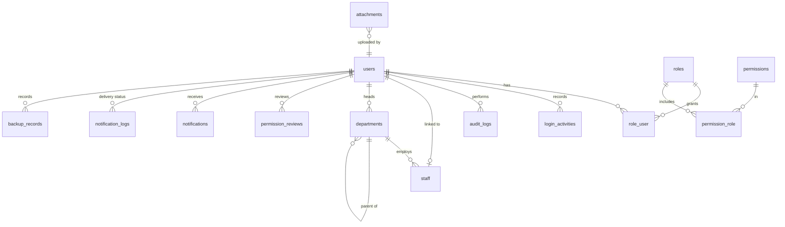
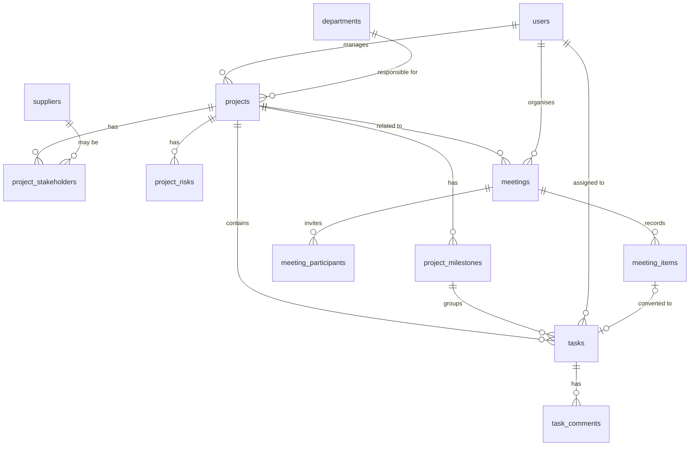
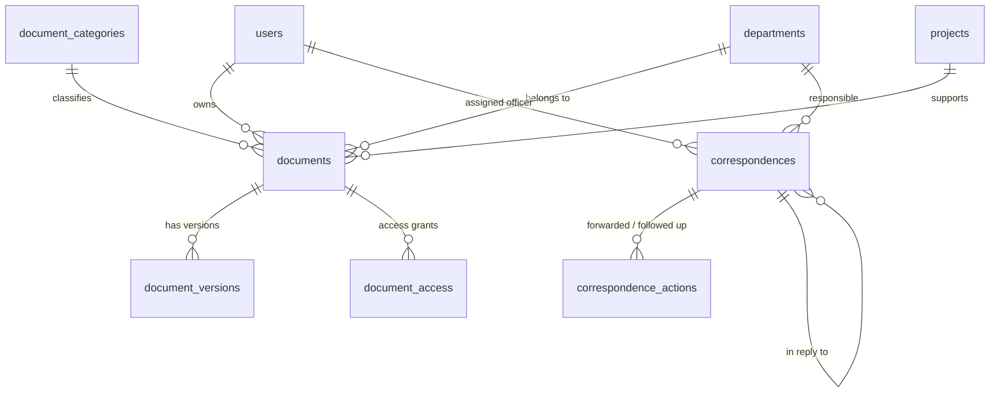
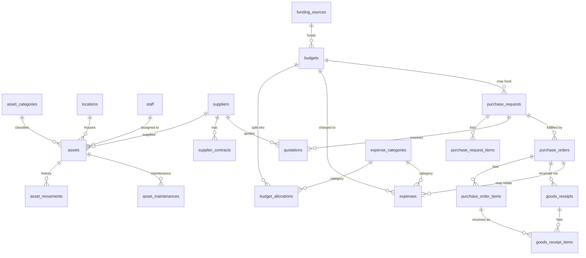

# Database design and ERD

MySQL 8 (InnoDB, `utf8mb4_unicode_ci`). The schema is defined only by the Laravel
migrations in `database/migrations`; never change tables by hand.

## Conventions

| Convention | Rule |
|---|---|
| Keys | `id` BIGINT UNSIGNED auto-increment; foreign keys are real InnoDB constraints. |
| References | Human reference numbers (`reference`, `asset_tag`, `code`) are `UNIQUE` and produced by `App\Support\ReferenceNumber` from `number_sequences` under a row lock. |
| Money | `DECIMAL(15,2)`; quantities `DECIMAL(12,2)`. No floating-point columns are used for money. |
| Userstamps | `created_by`, `updated_by` → `users.id` (`ON DELETE SET NULL`). |
| Deletion | Business records use soft deletes (`deleted_at`) or an explicit archive flag/status. Users are never hard-deleted. |
| History | `audit_logs` (append-only) stores old/new values for every audited model; workflow tables (`asset_movements`, `correspondence_actions`, `document_versions`, `goods_receipts`) keep domain history. |
| Polymorphic | `attachments`, `audit_logs`, `notifications`, `sent_reminders` use short morph aliases (`project`, `task`, …) defined in `AppServiceProvider`. |

## Entity relationship diagram

The diagram is split by area for readability (Mermaid syntax — renders on GitHub).

### Identity, organisation, cross-cutting

### Projects, tasks, meetings

### Documents and correspondence

### Assets, procurement, finance

## Tables by area

| Area | Tables |
|---|---|
| Identity & access | `users`, `roles`, `permissions`, `role_user`, `permission_role`, `login_activities`, `audit_logs`, `permission_reviews`, `password_reset_tokens`, `sessions` |
| Organisation | `departments`, `staff` |
| Projects & tasks | `projects`, `project_milestones`, `project_stakeholders`, `project_risks`, `tasks`, `task_comments` |
| Documents | `document_categories`, `documents`, `document_versions`, `document_access` |
| Correspondence | `correspondences`, `correspondence_actions` |
| Meetings | `meetings`, `meeting_participants`, `meeting_items` |
| Assets | `asset_categories`, `locations`, `assets`, `asset_movements`, `asset_maintenances` |
| Suppliers & procurement | `suppliers`, `supplier_contracts`, `purchase_requests`, `purchase_request_items`, `quotations`, `purchase_orders`, `purchase_order_items`, `goods_receipts`, `goods_receipt_items` |
| Finance | `funding_sources`, `expense_categories`, `budgets`, `budget_allocations`, `expenses` |
| Cross-cutting | `attachments`, `settings`, `number_sequences`, `notifications`, `notification_logs`, `sent_reminders`, `backup_records` |
| Framework | `cache`, `cache_locks`, `jobs`, `job_batches`, `failed_jobs`, `migrations` |

## Important business rules (enforced in code and tests)

1. **Reference numbers** are unique (`UNIQUE` index) and sequential per type and year: the
   `number_sequences` row is locked (`SELECT … FOR UPDATE`) inside the inserting transaction.
2. **Project progress** is derived from completed vs. non-cancelled tasks (fallback: milestones). It cannot be typed in.
3. **Tasks:** only the assignee updates progress or submits completion; tasks requiring approval move to
   `awaiting_approval`; the assignee can never approve their own task.
4. **Documents:** every file upload creates an immutable `document_versions` row; confidentiality
   (`public`, `internal`, `confidential`, `restricted`) is enforced by `Document::visibleTo()` for lists and
   `Document::canBeViewedBy()` for single records. Owners/registrars cannot approve their own documents.
5. **Procurement:** requester ≠ approver; purchase orders are raised only from approved requests by a
   procurement officer who is not the requester; goods are received by someone who is neither requester nor approver;
   received quantity cannot exceed ordered quantity.
6. **Finance:** remaining balance = allocated − approved expenditure (approved + paid + reconciled).
   An expense cannot be approved if it would exceed its category allocation (checked under a row lock).
   The preparer of a budget cannot approve it; the recorder of an expense cannot approve it; the approver cannot mark it paid.
   "Paid" and "reconciled" only record facts — the system performs no payments.
7. **Assets:** every assignment/transfer/return/retirement writes `asset_movements`; retired assets are read-only.
8. **Audit:** `audit_logs` rows are never updated or deleted by the application; passwords and MFA secrets are redacted.
9. **Retention:** nothing is deleted automatically. Document categories carry `retention_years`; `documents.retain_until` is computed at registration.

## Sensitive data held

Only work-related staff data is stored: name, staff number, job title, official email/phone, office,
employment status/type and dates. No national ID numbers, home addresses, salaries, bank details or
health data are collected. Employment fields are visible only with `staff.view_sensitive`.
MFA secrets and recovery codes are encrypted at rest with the application key.
