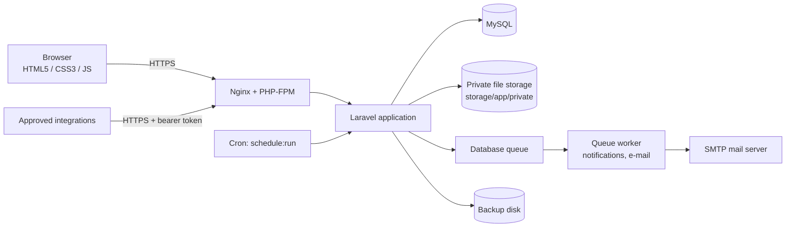

# Technical Architecture

## Overview

The NDC Somalia Management System is a server-rendered Laravel 13
application backed by MySQL. It is a modular monolith: every module shares
one codebase, database, authentication and audit trail, but keeps its
controllers, views, routes, policies and translations in its own folders so
modules can be extended or added (e.g. data center infrastructure) without
redeveloping the rest.

## Request pipeline

1. **Web middleware**: sessions (database driver, encrypted), CSRF,
   `SetLocale` (user preference → session → system default),
   `EnsureAccountIsUsable` (signs out suspended accounts, forces password
   change and administrator 2FA), `SecurityHeaders` (CSP without inline
   scripts, frame, MIME-sniffing and referrer protections, HSTS on HTTPS).
2. **Authentication**: e-mail + password (bcrypt), throttled (5 attempts per
   minute per account and IP), optional TOTP two-factor authentication with
   single-use recovery codes, password reset by e-mail.
3. **Authorisation**: `spatie/laravel-permission`. Permissions are declared
   in `config/ndc.php`; roles are database records editable in the
   interface. Routes use `permission:` middleware; each record action is
   checked by a policy; list queries apply record-level scopes
   (`visibleTo`). Super Administrators pass all checks through a
   `Gate::before` hook.
4. **Controllers** validate input server-side, write inside transactions
   where several rows change, and render Blade views.

## Cross-cutting services

| Service | Responsibility |
| --- | --- |
| `Auditable` trait + `Support\Audit` | Records create/update/archive/delete/restore with before/after values (passwords, tokens and secrets excluded, sensitive fields masked) plus explicit workflow events, sign-ins, failed sign-ins and exports. |
| `ApprovalService` | Generic approval requests for documents, purchase requests, budgets, expenses and asset disposals. Enforces the approver permission, separation of duties (requesters never approve their own requests) and one pending request per record. Notifies approvers and requesters. |
| `Support\FileStore` + `AttachmentController` | Validates uploads against configurable type/size limits (content and extension), stores them under random names on the private disk with a SHA-256 checksum, streams downloads only after the parent record's policy allows it. |
| `Support\ReferenceNumber` | Sequential official numbers per prefix and year (`NDC/IN/2026/0007`) using a locked counter table, safe under concurrency. |
| `Support\Settings` | Runtime settings (stored in `settings`, cached) with defaults in `config/ndc.php`. |
| Notifications | `GenericNotification` and approval notifications are queued, stored in-app and optionally e-mailed; translated into each recipient's language at delivery. |
| `SendRemindersCommand` | Daily reminders for approaching/overdue tasks, correspondence responses, meeting action points, upcoming meetings, document review/expiry, contract renewals, warranties and maintenance. Each record is reminded at most once per day. |
| `BackupService` | Database dump + uploaded files in a checksummed archive, verified after writing (see BACKUP_AND_RESTORE.md). |
| Reports (`app/Reports`) | Each report is a class declaring filters, columns and rows. The same class feeds the screen, PDF (dompdf) and CSV export, so they always agree. |

## Data model

All tables use `BIGINT` ids, foreign keys with explicit delete behaviour,
indexes on status/date columns used by filters, and `deleted_at` (soft
delete) on primary records so archived data is never lost by accident.
Polymorphic columns (attachments, approvals, audit log) store stable aliases
(`project`, `document`, …) defined in `AppServiceProvider::MORPH_MAP`, not
PHP class names.

```mermaid
erDiagram
    departments ||--o{ users : "has"
    departments ||--o{ staff : "employs"
    users ||--o| staff : "profile"
    staff ||--o{ staff_trainings : ""
    users }o--o{ roles : "model_has_roles"
    roles }o--o{ permissions : "role_has_permissions"

    projects ||--o{ project_milestones : ""
    projects ||--o{ project_risks : ""
    projects ||--o{ project_stakeholders : ""
    projects }o--o{ users : "project_members"
    projects ||--o{ tasks : ""
    project_milestones ||--o{ tasks : ""
    tasks ||--o{ task_comments : ""

    documents ||--o{ document_versions : ""
    documents }o--o{ users : "document_user (grants)"
    documents ||--o{ document_access_logs : ""
    categories ||--o{ documents : "type"

    correspondences ||--o{ correspondence_actions : ""
    correspondences ||--o{ correspondences : "replies"

    meetings ||--o{ meeting_participants : ""
    meetings ||--o{ meeting_action_items : ""

    assets ||--o{ asset_assignments : ""
    assets ||--o{ asset_maintenances : ""
    assets ||--o{ asset_disposals : ""
    suppliers ||--o{ assets : ""

    suppliers ||--o{ supplier_evaluations : ""
    procurement_requests ||--o{ procurement_request_items : ""
    procurement_requests ||--o{ quotations : ""
    procurement_requests ||--o{ purchase_orders : ""
    suppliers ||--o{ purchase_orders : ""
    purchase_orders ||--o{ goods_receipts : ""
    goods_receipts ||--o{ goods_receipt_items : ""

    budgets ||--o{ budget_allocations : "planned"
    budgets ||--o{ expenses : "actual"
    projects ||--o{ budgets : ""
    departments ||--o{ budgets : ""
```

Shared polymorphic tables: `attachments`, `approvals`, `audit_logs`,
`notifications`. Support tables: `settings`, `categories` (reference lists),
`sequences` (reference numbers), `backup_runs`, `sessions`, `jobs`,
`failed_jobs`, `personal_access_tokens`.

### Status vocabularies

Every status column takes its values from `config/statuses.php` (value →
label, badge tone). Validation, filters, badges and reports all read from
there, so adding a status is a one-line change plus its translation.

## Modules

| Module | Key tables | Route file | Permissions |
| --- | --- | --- | --- |
| Dashboard | (reads all) | `routes/web.php` | `dashboard.view` |
| Projects | projects, project_* | `routes/modules/projects.php` | `projects.*` |
| Tasks & workflow | tasks, task_comments | `routes/modules/tasks.php` | `tasks.*` |
| Staff | staff, staff_trainings | `routes/modules/staff.php` | `staff.*` |
| Documents | documents, document_* | `routes/modules/documents.php` | `documents.*` |
| Correspondence | correspondences, correspondence_actions | `routes/modules/correspondence.php` | `correspondence.*` |
| Meetings & calendar | meetings, meeting_* | `routes/modules/meetings.php` | `meetings.*` |
| Assets | assets, asset_* | `routes/modules/assets.php` | `assets.*` |
| Procurement & suppliers | suppliers, procurement_*, quotations, purchase_orders, goods_receipt* | `routes/modules/procurement.php` | `procurement.*`, `suppliers.manage` |
| Budgets & expenses | budgets, budget_allocations, expenses | `routes/modules/budgets.php` | `budgets.*`, `expenses.*` |
| Reports | (reads all) | `routes/modules/reports.php` | `reports.*` + module view permission |
| Administration | users, roles, departments, categories, settings, audit_logs, backup_runs | `routes/modules/admin.php` | `users.manage`, `roles.manage`, … |
| API | (reads) | `routes/api/*.php` | `api.access` + module view permission |

## Localisation

Interface strings are written in English inside `__()` and translated into
Somali through JSON files: `lang/modules/{module}/so.json` (registered
automatically) and Laravel's validation/auth messages in `lang/so/*.php`.
Each user chooses a language; e-mails and notifications are rendered in the
recipient's language. The `<html dir>` attribute comes from
`config('ndc.locales')`, so a right-to-left language can be added without
template changes. Reference data (departments, categories) has an English and
a Somali name.

## Security measures

| Threat | Measure |
| --- | --- |
| SQL injection | Eloquent/query builder parameter binding; sort columns and filter values allow-listed. |
| XSS | Blade escaping; strict Content Security Policy (`script-src 'self'`, no inline scripts). |
| CSRF | Laravel CSRF tokens on every state-changing form; `SameSite=Lax` cookies. |
| Brute force | Login and 2FA throttling; failed sign-ins audited. |
| Session hijack | Session regeneration on login, encrypted secure cookies, idle timeout, "sign out other sessions", automatic sign-out of suspended users. |
| Privilege escalation | Permission middleware + policies + record scopes; only Super Administrators can grant the Super Administrator role; users cannot remove their own admin access. |
| File upload abuse | Extension and content-type allow-list (executables always blocked), size limit, random storage names, private disk, `nosniff` downloads. |
| CSV injection | Exported cells beginning with `= + - @` are neutralised. |
| Data at rest | Sensitive staff fields, two-factor secrets and recovery codes are encrypted with `APP_KEY`. Passwords use bcrypt. |
| Secrets | Only in `.env` (git-ignored); `.env.example` contains no secrets; DB password passed to `mysqldump` via environment. |
| Repudiation | Append-only audit log of changes, approvals, sign-ins, downloads and exports. |

## Future expansion

The schema and code were laid out so the SRS's future modules slot in:

- **Data center infrastructure** (servers, racks, storage, network): asset
  categories for these already exist and `assets.specifications` (JSON)
  holds technical attributes today; a dedicated `racks`/`rack_units` module
  can reference `assets.id` later.
- **Monitoring, SIEM, power/cooling**: integrate through new API endpoints
  with their own token abilities, and new report classes in `app/Reports`.
- **MDA service requests / customer portal**: a separate guard and route
  file; reuse the approval, notification and attachment services.
- **Accounting integration**: budgets and expenses expose clean totals that
  can be exported or synchronised; no payment logic exists in V1 by design.

New modules follow docs/DEVELOPMENT.md: add permissions to `config/ndc.php`,
a migration, models, a route file in `routes/modules`, policies, views and a
`lang/modules/{module}/so.json`.
